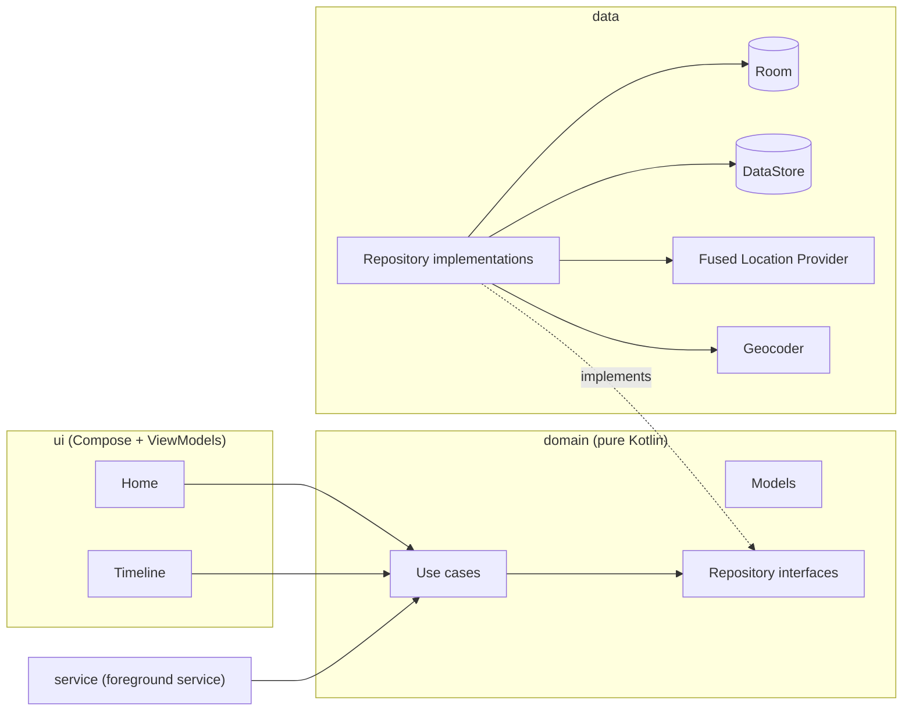
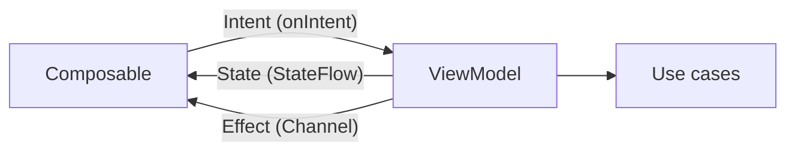

# Location Logger

An Android app that records where the device is every 10 minutes, including while the app is
minimised or closed, and shows the history on a paged, day-grouped timeline.

Each entry stores the time, latitude, longitude, accuracy and the street address resolved from
those coordinates. Everything is kept locally in a Room database.

## Features

- **Background logging.** A foreground service captures a location as soon as logging starts
  and then every 10 minutes. It keeps going when the app is minimised, swiped away from recents,
  or the screen is off.
- **Street addresses.** Coordinates are reverse geocoded when captured. If that fails (for example
  with no network), the entry is still saved, and the address is retried when the entry is
  scrolled into view on the timeline.
- **Timeline.** Entries are listed newest first on a vertical rail, grouped under sticky day headers
  ("Today", "Yesterday", "Thu, 24 Sep"). The time is shown first, then the address and a
  monospaced coordinates line with accuracy. The newest entry pulses while logging is active.
- **Paging.** The timeline loads 15 entries per request, the first request included, and new
  entries appear live without a manual refresh.
- **Designed states.** A shimmer skeleton while loading, an empty state, an error state with retry,
  a loading footer and an end-of-history marker.
- **Home screen.** Start/Pause with an animated status card, stats (entries and last capture),
  the latest location, and guidance cards for missing permissions or location being off.
- **Notification.** It shows the last address and has a Pause action.
- **Light and dark theme** with a custom palette (dynamic colour is off so the app keeps its own look).

## Architecture

The app follows the [official Android architecture guidance](https://developer.android.com/topic/architecture):
three layers with dependencies pointing inwards, and MVI in the UI layer.



- **domain** holds the models (`LocationEntry`, `TrackingStatus`, ...), the repository
  interfaces and single-purpose use cases. It has no Android imports; Paging's `PagingData`
  is the one exception, so the paged history can be expressed in the domain.
- **data** implements the interfaces: Room for entries, DataStore for the on/off flag, the
  Fused Location Provider for fixes and the platform `Geocoder` for addresses.
- **service** and **ui** only talk to use cases. Hilt wires everything together.

### MVI in the UI layer



Every screen has a contract with three types:

- **State**: one immutable data class, exposed as a `StateFlow`.
- **Intent**: a sealed interface of user actions, passed to `onIntent`.
- **Effect**: one-shot events such as navigation, permission requests and snackbars. They are
  delivered through a `Channel`, so they are neither replayed nor lost across configuration
  changes.

The ViewModels share a small `MviViewModel` base. The timeline's paged list is exposed next to
its state as a `Flow<PagingData>`, since `PagingData` is a stream rather than a value.

Navigation uses type-safe Navigation Compose routes (`@Serializable` objects).

### Capturing a location

1. Start saves the "logging on" flag in DataStore and starts `LocationTrackingService` as a
   foreground service of type `location`.
2. The service registers one Fused Location Provider request with a fixed 10-minute interval
   and high accuracy. The first fix is delivered right away. A cached fix older than 30 seconds
   is not accepted, so an entry is never stamped with an old position.
3. For each fix the service holds a short partial wake lock, resolves the address (giving up
   after 10 seconds), inserts the entry and updates the notification.
4. Room's paging source is invalidated by the insert, so an open timeline updates itself.

## Keeping it running in the background

| Situation | What happens |
|---|---|
| App minimised or screen off | The foreground service keeps running and receives fixes. |
| Swiped away from recents | The service is independent of the activity and keeps running. |
| Doze | Location updates for a foreground location service keep arriving in Doze, unlike a coroutine `delay()` loop, which is why the schedule is driven by the location request itself. |
| Notification dismissed (Android 14+) | The notification is posted again with the next capture. |
| Process killed by the system | The service is `START_STICKY`. On restart it resumes only if logging is still on and background location is granted. |
| Restart not possible (no background location, force stop, reboot) | The flag stays on, and logging resumes as soon as the app is opened again. |
| Location switched off | The service stays up and the notification says so. Captures resume by themselves when location comes back on. |
| Location permission revoked | Logging is switched off instead of crashing on the next start. |

Logging deliberately does not start on boot and does not ask for a battery-optimisation
exemption. Both were left out to keep the permission footprint small.

## Permissions

| Permission | Why |
|---|---|
| `ACCESS_FINE_LOCATION` / `ACCESS_COARSE_LOCATION` | Required. Precise location is needed; with approximate only, Start stays disabled and a card offers the upgrade. |
| `POST_NOTIFICATIONS` (13+) | Requested together with location. Logging still works without it, but the notification isn't shown. |
| `ACCESS_BACKGROUND_LOCATION` | Optional. Only needed for the service to resume by itself after the system restarts it. Offered on a separate card, as Android requires. |
| `FOREGROUND_SERVICE`, `FOREGROUND_SERVICE_LOCATION` | Running the location foreground service. |
| `WAKE_LOCK` | Finishing geocoding and the database write after a fix wakes the device. |
| `INTERNET` | Reverse geocoding. |

The flow on the Home screen:

1. Tapping Start requests fine + coarse location (and notifications on 13+) in one dialog.
2. If the permission is denied permanently, a card links to the app's settings.
3. With the permission granted, the location settings are checked. If device location is off, the
   system "Turn on location" dialog is shown, and logging starts only when it's on.
4. Permissions are read again every time the screen resumes, so changes made in Settings show up
   immediately.

## Tech stack

| Area | Choice | Why |
|---|---|---|
| Language | Kotlin 2.4 | |
| UI | Jetpack Compose, Material 3 | Declarative UI; the timeline rail and animations are drawn with Canvas. |
| Architecture | MVI, Hilt, Coroutines and Flow | One state object per screen, explicit intents, and compile-time dependency injection. |
| Database | Room 2.8 (with `room-paging`) | The DAO returns a `PagingSource` that invalidates itself on writes. The schema is exported to `app/schemas`. |
| Paging | Paging 3 | `pageSize` and `initialLoadSize` are both 15, and `insertSeparators` adds the day headers. |
| Location | Play Services Fused Location Provider | Better accuracy and battery use than raw GPS, and reliable delivery to a foreground service. |
| Addresses | Platform `Geocoder` | No API key. Uses the async API on Android 13+ and a background dispatcher below. |
| Preferences | DataStore | Keeps the logging flag across process death. |
| Navigation | Navigation Compose with Kotlin Serialization | Type-safe routes. |
| Annotation processing | KSP | For Room and Hilt. |

Min SDK 26, target SDK 37. All versions are in `gradle/libs.versions.toml`.

## Project structure

```
app/src/main/java/com/example/locationlogger/
  LocationLoggerApp.kt   Hilt application
  MainActivity.kt        hosts navigation; resumes interrupted logging on start
  di/                    Hilt modules
  domain/
    model/               LocationEntry, LocationFix, GeoPoint, TrackingStatus, TrackingSummary
    repository/          repository interfaces
    usecase/             one class per use case
    TrackingConfig.kt    CAPTURE_INTERVAL
  data/
    local/               Room database, DAO, entity, mappers, DataStore preferences
    location/            Fused Location source, Geocoder address resolver
    repository/          repository implementations
  service/               foreground service and its notification
  ui/
    mvi/                 MviViewModel base and effect collection
    navigation/          routes and NavHost
    home/                Home screen, contract, ViewModel, permission helpers
    timeline/            Timeline screen, contract, ViewModel, rail and state components
    components/          shared composables
    format/              time and coordinate formatting
    theme/               colours, typography, shapes
app/schemas/             exported Room schema
```

## Building and running

Requirements: Android Studio (latest stable), Android SDK Platform 37. Gradle provisions its
own JDK through the toolchain settings.

```bash
./gradlew assembleDebug     # build
./gradlew installDebug      # install on a connected device or emulator
./gradlew lint              # static checks
```

On Windows, use `gradlew.bat`.

### Testing with a shorter interval

Waiting 10 minutes between entries makes manual testing slow. The interval is a single
constant in `domain/TrackingConfig.kt`:

```kotlin
val CAPTURE_INTERVAL: Duration = 10.minutes
```

Change it to `1.minutes`, reinstall, and entries arrive about once a minute. Everything else,
including the interval shown on the Home screen, follows the constant. Set it back to 10 minutes
afterwards.

A few commands that help when checking background behaviour:

```bash
adb shell dumpsys deviceidle force-idle       # enter Doze (screen off, unplugged)
adb shell dumpsys deviceidle unforce
adb shell am crash com.example.locationlogger # simulate the process being killed
```

The database can be browsed live in Android Studio with **App Inspection > Database Inspector**.
